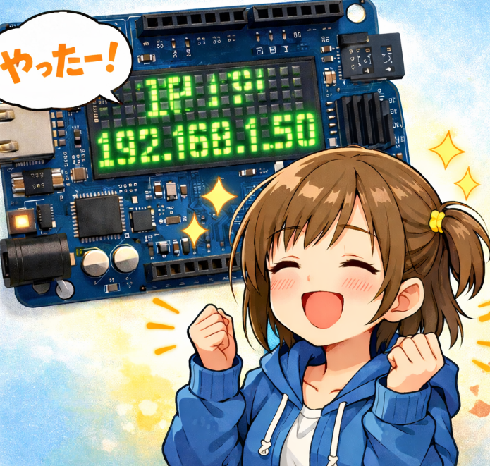

# 【unoQ】起動時にIPアドレスと温度をMatrixに表示するにょ【小さなLinux機】

2026年3月5日 18:23



# Arduino UNO Q + LED Matrix IP/温度表示

## システム構成

Linux (QRB) が IP アドレスと CPU 温度を取得し、RouterBridge 経由で Arduino(STM32) の LED マトリクスにスクロール表示します。

| 要素 | 役割・接続先 |
| --- | --- |
| Linux (RQB) | send_info.py を実行する側 |
| send_info.py | IPアドレス取得、CPU温度取得を行い、arduino-router へ渡す |
| arduino-router (Unixソケット: /var/run/arduino-router.sock) | /dev/ttyHS1 へ中継 |
| /dev/ttyHS1 | Arduino UNO Q への接続 |
| Arduino UNO Q | LEDマトリクスにスクロール表示 |

---

## 1. Arduino UNO Q 側の準備

### 1-1. ライブラリの競合を解消

古いライブラリが優先されると `'RPC' was not declared` や `'class BridgeClass' has no member 'bind'` エラーが発生します。以下のフォルダを別の場所（デスクトップなど）に移動してください。

```
..libraries\Arduino_RouterBridge
..libraries\Arduino_RPClite
```

移動後、Arduino IDE を再起動します。

### 1-2. スケッチ

3×5 ピクセルの自前フォントで英数字・記号をすべてカバーします。

```cpp
#include <Arduino_RouterBridge.h>
#include <Arduino_LED_Matrix.h>

Arduino_LED_Matrix matrix;

#define WIDTH  13
#define HEIGHT  8

const uint8_t font3x5[][5] = {
  // 0-9
  {0b111,0b101,0b101,0b101,0b111}, //  0  '0'
  {0b010,0b110,0b010,0b010,0b111}, //  1  '1'
  {0b111,0b001,0b111,0b100,0b111}, //  2  '2'
  {0b111,0b001,0b111,0b001,0b111}, //  3  '3'
  {0b101,0b101,0b111,0b001,0b001}, //  4  '4'
  {0b111,0b100,0b111,0b001,0b111}, //  5  '5'
  {0b111,0b100,0b111,0b101,0b111}, //  6  '6'
  {0b111,0b001,0b010,0b010,0b010}, //  7  '7'
  {0b111,0b101,0b111,0b101,0b111}, //  8  '8'
  {0b111,0b101,0b111,0b001,0b111}, //  9  '9'
  // A-Z (10-35)
  {0b010,0b101,0b111,0b101,0b101}, // 10  'A'
  {0b110,0b101,0b110,0b101,0b110}, // 11  'B'
  {0b111,0b100,0b100,0b100,0b111}, // 12  'C'
  {0b110,0b101,0b101,0b101,0b110}, // 13  'D'
  {0b111,0b100,0b111,0b100,0b111}, // 14  'E'
  {0b111,0b100,0b111,0b100,0b100}, // 15  'F'
  {0b111,0b100,0b101,0b101,0b111}, // 16  'G'
  {0b101,0b101,0b111,0b101,0b101}, // 17  'H'
  {0b111,0b010,0b010,0b010,0b111}, // 18  'I'
  {0b001,0b001,0b001,0b101,0b111}, // 19  'J'
  {0b101,0b101,0b110,0b101,0b101}, // 20  'K'
  {0b100,0b100,0b100,0b100,0b111}, // 21  'L'
  {0b101,0b111,0b111,0b101,0b101}, // 22  'M'
  {0b101,0b111,0b111,0b111,0b101}, // 23  'N'
  {0b111,0b101,0b101,0b101,0b111}, // 24  'O'
  {0b111,0b101,0b111,0b100,0b100}, // 25  'P'
  {0b111,0b101,0b101,0b111,0b001}, // 26  'Q'
  {0b110,0b101,0b110,0b101,0b101}, // 27  'R'
  {0b111,0b100,0b111,0b001,0b111}, // 28  'S'
  {0b111,0b010,0b010,0b010,0b010}, // 29  'T'
  {0b101,0b101,0b101,0b101,0b111}, // 30  'U'
  {0b101,0b101,0b101,0b010,0b010}, // 31  'V'
  {0b101,0b101,0b111,0b111,0b101}, // 32  'W'
  {0b101,0b101,0b010,0b101,0b101}, // 33  'X'
  {0b101,0b101,0b010,0b010,0b010}, // 34  'Y'
  {0b111,0b001,0b010,0b100,0b111}, // 35  'Z'
  // a-z (36-61)
  {0b000,0b011,0b101,0b101,0b011}, // 36  'a'
  {0b100,0b100,0b110,0b101,0b110}, // 37  'b'
  {0b000,0b011,0b100,0b100,0b011}, // 38  'c'
  {0b001,0b001,0b011,0b101,0b011}, // 39  'd'
  {0b000,0b111,0b101,0b110,0b011}, // 40  'e'
  {0b011,0b100,0b111,0b100,0b100}, // 41  'f'
  {0b000,0b011,0b101,0b011,0b001}, // 42  'g'
  {0b100,0b100,0b110,0b101,0b101}, // 43  'h'
  {0b010,0b000,0b010,0b010,0b010}, // 44  'i'
  {0b001,0b000,0b001,0b101,0b111}, // 45  'j'
  {0b100,0b101,0b110,0b101,0b101}, // 46  'k'
  {0b110,0b010,0b010,0b010,0b111}, // 47  'l'
  {0b000,0b101,0b111,0b111,0b101}, // 48  'm'
  {0b000,0b110,0b101,0b101,0b101}, // 49  'n'
  {0b000,0b010,0b101,0b101,0b010}, // 50  'o'
  {0b000,0b110,0b101,0b110,0b100}, // 51  'p'
  {0b000,0b011,0b101,0b011,0b001}, // 52  'q'
  {0b000,0b011,0b100,0b100,0b100}, // 53  'r'
  {0b000,0b011,0b110,0b001,0b110}, // 54  's'
  {0b010,0b111,0b010,0b010,0b001}, // 55  't'
  {0b000,0b101,0b101,0b101,0b011}, // 56  'u'
  {0b000,0b101,0b101,0b101,0b010}, // 57  'v'
  {0b000,0b101,0b111,0b111,0b101}, // 58  'w'
  {0b000,0b101,0b010,0b010,0b101}, // 59  'x'
  {0b000,0b101,0b101,0b011,0b001}, // 60  'y'
  {0b000,0b111,0b001,0b110,0b111}, // 61  'z'
  // 記号 (62-)
  {0b000,0b000,0b000,0b000,0b010}, // 62  '.'
  {0b000,0b000,0b000,0b000,0b000}, // 63  ' '
  {0b000,0b000,0b111,0b000,0b000}, // 64  '-'
  {0b000,0b010,0b111,0b010,0b000}, // 65  '+'
  {0b001,0b001,0b010,0b100,0b100}, // 66  '/'
  {0b000,0b010,0b000,0b010,0b000}, // 67  ':'
  {0b101,0b001,0b010,0b100,0b101}, // 68  '%'
  {0b010,0b010,0b010,0b000,0b010}, // 69  '!'
  {0b111,0b001,0b011,0b000,0b010}, // 70  '?'
  {0b110,0b110,0b000,0b000,0b000}, // 71  '°' (0xB0)
};

char currentDisplayBuffer[128] = "Waiting QRB...";
volatile bool newMessage = false;

inline int charIndex(uint8_t c) {
  if (c >= '0' && c <= '9') return c - '0';
  if (c >= 'A' && c <= 'Z') return c - 'A' + 10;
  if (c >= 'a' && c <= 'z') return c - 'a' + 36;
  if (c == '.')  return 62;
  if (c == ' ')  return 63;
  if (c == '-')  return 64;
  if (c == '+')  return 65;
  if (c == '/')  return 66;
  if (c == ':')  return 67;
  if (c == '%')  return 68;
  if (c == '!')  return 69;
  if (c == '?')  return 70;
  if (c == 0xB0) return 71;
  return -1;
}

inline bool isNarrow(int idx) {
  return idx == 62 || idx == 63 ||  // '.' ' '
         idx == 67 ||               // ':'
         idx == 44 ||               // 'i'
         idx == 69;                 // '!'
}

int measureWidth(const char* t) {
  int w = 0;
  for (int i = 0; t[i]; i++) {
    uint8_t c = (uint8_t)t[i];
    if (c == 0xC2) continue;
    int idx = charIndex(c);
    if (idx < 0) continue;
    w += isNarrow(idx) ? 2 : 4;
  }
  return w;
}

void scrollText(const char* text) {
  int textWidth = measureWidth(text);
  for (int offset = WIDTH; offset > -textWidth; offset--) {
    uint8_t frame[HEIGHT][WIDTH] = {};
    int x = offset;
    for (int i = 0; text[i]; i++) {
      uint8_t c = (uint8_t)text[i];
      if (c == 0xC2) continue;
      int idx = charIndex(c);
      if (idx < 0) continue;
      int w = isNarrow(idx) ? 1 : 3;
      for (int row = 0; row < 5; row++) {
        uint8_t line = font3x5[idx][row];
        for (int col = 0; col < w; col++) {
          int px = x + col;
          int py = row + 1;
          if (px >= 0 && px < WIDTH && py >= 0 && py < HEIGHT) {
            // 幅3: shift=2,1,0  幅1: shift=0
            int shift = (w == 1) ? 1 : (2 - col);
            frame[py][px] = (line >> shift) & 0x01;
          }
        }
      }
      x += w + 1;
    }
    matrix.renderBitmap(frame, HEIGHT, WIDTH);
    if (newMessage) return;
    delay(50);
  }
}

void onReceiveMsg(MsgPack::str_t msg) {
  strncpy(currentDisplayBuffer, msg.c_str(), sizeof(currentDisplayBuffer) - 1);
  currentDisplayBuffer[sizeof(currentDisplayBuffer) - 1] = '\0';
  Monitor.println(currentDisplayBuffer);
  newMessage = true;
}

void setup() {
  Monitor.begin();
  matrix.begin();
  Bridge.begin();
  Bridge.provide("sendText", onReceiveMsg);
}

void loop() {
  newMessage = false;
  scrollText(currentDisplayBuffer);
}
```

> **ポイント:** `Bridge.bind()` ではなく `Bridge.provide()` を使います。`PROGMEM` / `pgm_read_byte` は Zephyr では不要です。

---

## 2. Linux (QRB) 側の準備

### 2-1. ライブラリのインストール

```bash
python3 -m pip install pyserial msgpack --break-system-packages
```

### 2-2. 送信スクリプト (~/send_info.py)

```python
#!/usr/bin/env python3
import socket
import msgpack

SOCK_PATH = "/var/run/arduino-router.sock"

def get_ip():
    try:
        s = socket.socket(socket.AF_INET, socket.SOCK_DGRAM)
        s.connect(("8.8.8.8", 80))
        ip = s.getsockname()[0]
        s.close()
        return ip
    except Exception:
        return "0.0.0.0"

def get_cpu_temp():
    try:
        with open("/sys/class/thermal/thermal_zone0/temp") as f:
            return float(f.read().strip()) / 1000.0
    except Exception:
        return 0.0

def send_rpc(text):
    request = [0, 1, "sendText", [text]]
    packed = msgpack.packb(request, use_bin_type=True)
    with socket.socket(socket.AF_UNIX, socket.SOCK_STREAM) as s:
        s.connect(SOCK_PATH)
        s.sendall(packed)
        data = s.recv(1024)
        unpacker = msgpack.Unpacker(raw=False)
        unpacker.feed(data)
        for msg in unpacker:
            return msg
    return None

def main():
    ip = get_ip()
    temp = get_cpu_temp()
    text = f"{ip} {temp:.1f}°C"
    print(f"送信: {text}")
    response = send_rpc(text)
    print(f"レスポンス: {response}" if response else "レスポンスなし")

if __name__ == "__main__":
    main()
```

> **ポイント:** `arduino-router` がすでに `/dev/ttyHS1` を占有しているため、シリアルポートへの直接アクセスは NG です。Unixソケット経由で送信します。

### 2-3. 手動実行

```bash
python3 ~/send_info.py
```

---

## 3. 起動時に自動実行 (rc.local)

`arduino-router` は起動時に自動起動するため手動起動は不要です。`send_info.py` だけ rc.local に登録します。

```bash
sudo vi /etc/rc.local
```

```bash
#!/bin/bash

# ネットワーク待ち（最大60秒）
for i in $(seq 1 60); do
    ip=$(python3 -c "import socket; s=socket.socket(socket.AF_INET, socket.SOCK_DGRAM); s.connect(('8.8.8.8',80)); print(s.getsockname()[0]); s.close()" 2>/dev/null)
    if [ "$ip" != "" ] && [ "$ip" != "0.0.0.0" ]; then
        break
    fi
    sleep 1
done

# Unixソケット待ち（最大60秒）
for i in $(seq 1 60); do
    if [ -S /var/run/arduino-router.sock ]; then
        break
    fi
    sleep 1
done

# UNO Q の provide 登録待ち
sleep 5

/usr/bin/python3 /home/arduino/send_info.py &
exit 0
```

```bash
sudo chmod +x /etc/rc.local
```

---

## 4. トラブルシューティング

| エラー | 原因 | 対処 |
|--------|------|------|
| `'RPC' was not declared` | 古いライブラリが優先されている | `..libraries` の競合ライブラリを移動 |
| `has no member 'bind'` | 同上 + APIの誤り | 同上。`bind` → `provide` に変更 |
| `Device or resource busy` | arduino-router が /dev/ttyHS1 を占有中 | Unixソケット経由で送信する |
| `ModuleNotFoundError: msgpack` | root環境にインストールされていない | `sudo python3 -m pip install msgpack --break-system-packages` |
| `送信: 0.0.0.0` | ネットワーク未準備 | rc.local のネットワーク待ちループを確認 |
| `method sendText not available` | UNO Q 未起動 | rc.local に `sleep 5` を追加 |

---

## 5. 表示可能な文字

3×5 ピクセルの自前フォントで以下の文字に対応しています。

| 種類 | 文字 |
|------|------|
| 数字 | `0` 〜 `9` |
| 大文字 | `A` 〜 `Z` |
| 小文字 | `a` 〜 `z` |
| 記号 | `. - + / : % ! ?` |
| 特殊 | `°` (度記号 UTF-8: `\xC2\xB0`) |

それ以外の文字は無視されます。フォントを追加したい場合は `font3x5` テーブルと `charIndex()` を拡張してください。

## 6. 実機
（X 投稿の埋め込み）
## 7. 最後に
もうこれ..デフォルトで組み込んでおいて欲しいにょ

<div class="like-wrap"><div data-lyket-type="like" data-lyket-namespace="linalog" data-lyket-color-icon="#b5e853" data-lyket-color-primary="#b5e853" data-lyket-color-text="#eaeaea" data-lyket-color-secondary="#2b2b2b" data-lyket-id="unoq-matrix-ip"></div></div>
