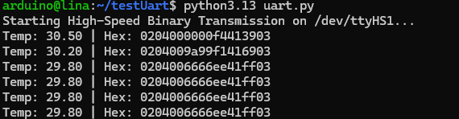
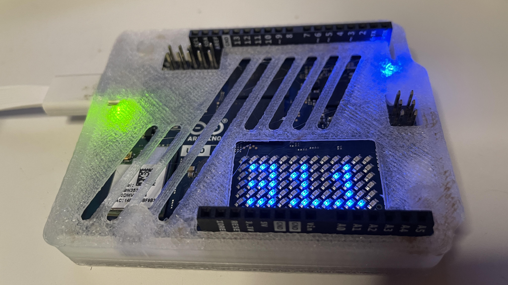

# 【unoQ】さっそく簡単にQRBとSTM32U5通信させたにょ【小さなLinux機】

2026年2月9日 17:57


[第一章 初期化](../unoq-setup/)
[第二章 QRB/MCU通信](../unoq-qrb-stm32/)
[第三章 デスクトップを液晶に](../unoq-x11-lcd/)
[第四章 ROS2を簡単に](../unoq-ros2/)
[第五章 Windowsを動かす](../unoq-windows/)

# QRB(Linux)・Uno Q(STM32U5) 直結バイナリ通信によるシステム制御
arduino-router を廃し
16bit LEN プロトコルで LED Matrix を物理メモリとして操る
いやArduino App Labが不安定すぎて良く判らないので
# はじめに：ミドルウェアという「壁」を壊す
Qualcomm Robotics Board (QRB) と Uno Q (STM32U5) の標準環境には、通信を仲介する arduino-router が存在します。しかし、これは内部でデータをパケット化し、論理ポートへ振り分ける「抽象化レイヤー」であり、リアルタイム性が要求されるバイナリ通信においては、ジッタ（遅延の揺れ）とデータの不透明化を招く障壁となります。
本稿では、この arduino-router を物理的に停止させ、Linux側の /dev/ttyHS1 と MCU側の UART を「完全透過」な状態で直結。独自定義の 16bit LEN 拡張プロトコル を用いて、ハードウェア性能を極限まで引き出す手法を解説します。
## Linuxレイヤー：arduino-router の解体とRaw制御
### サービスの完全停止と恒久的な無効化
arduino-router が動作していると、バイナリデータ中の特定コード（0x02, 0x03など）が制御コマンドとして誤認され、ペイロードが破壊される恐れがあります。
#### サービスの即時停止
````
sudo systemctl stop arduino-router
`````

#### 自動起動の無効化（再起動後も直結モードを維持）
````
sudo systemctl disable arduino-router
````
### TTYドライバの物理設定（921,600 bps）
**/dev/ttyHS1** は、Qualcommの高精度クロック直結の高速UARTです。
標準の115.2kbpsではなく、921,600 bps を選択します。これはSTM32U5のクロック分周比において誤差が極めて少なく、1Mbpsに迫る帯域を最も安定して維持できる「黄金のボーレート」です。

さらに、OSによる文字置換処理（CR/LF変換など）を完全に排除する Rawモード 設定が不可欠です。
````
sudo stty -F /dev/ttyHS1 921600 raw -echo -echoe -echok
````
## プロトコル設計：16bit LEN 拡張型バイナリフレームの必然性
データ長（LEN）をあえて 2バイト（16bit） に拡張しました。これには明確なアーキテクチャ上の設計思想があります。
### 独自フレームの構造（計9バイト）

|オフセット|名前|型|役割|
|---|---|---|---|
|0|STX|uint8_t|0x02 フレームの開始同期|
|1-2|LEN|uint16_t|16bit拡張|リトルエンディアン配置|
|3-6|DATA|float|浮動小数点データ（4バイト）|
|7|CRC|uint8_t|エラー検知用|LEN+DATAの加算和|
|8|ETX|uint8_t|0x03 フレームの終端|

### なぜ 16bit LEN なのか
現在送信しているのは float (4byte) ですが、本システムは将来的に 13x8 LEDマトリックスの全ピクセルデータ（104バイト〜） や、さらなる高解像度拡張を見据えています。
8bit LEN では最大255バイトに制限されますが、16bit化により、一括での全画面ビットマップ転送やログデータ転送へのスケールアップを、プロトコル変更なしに実現可能にしています。
## エラー検知：CRC加算和の計算アルゴリズム
堅牢性を担保するため、パケットの「中身」を対象としたCRCを算出します。
### Python側計算（送信時）
```
import struct
# LEN (2byte) と DATA (4byte) を含めた合計を 0xFF でマスク
len_val = 4
len_bytes = struct.pack('<H', len_val) 
float_bytes = struct.pack('<f', temp_value)
crc = (sum(len_bytes) + sum(float_bytes)) & 0xFF
````
### MCU側計算（受信時）
MCU側では受信ステートマシン内で順次加算を行い、受信完了と同時に計算を終わらせます。
````
	case WAIT_DATA:
    rx_payload[idx++] = b;
    calc_crc += b; // 受信しながら累積加算
    if (idx >= d_len) state = WAIT_CRC;
    break
````
## Uno Q (STM32U5) の物理メモリハック
### 13x8 LED マトリックスのメモリマップ
Uno Q の Arduino_LED_Matrix ライブラリは Zephyr OS 上で実装されており、その内部バッファは 13列 × 8行 = 104バイト の uint8_t 配列です。
matrix.setGrayscaleBits(1); を設定することで、この 104バイトのメモリ領域は各ドットの ON/OFF 制御に 1:1 で対応します。
- アドレッシング: frame[y * 13 + x]
- マッピング: frame[0] (左上) 〜 frame[103] (右下)

### union による型変換の高速化
受信した 4バイトを float に変換する際、memcpy やビットシフトを介さず、メモリを直接共有する union（共用体）を使用します。これにより、STM32U5 の FPU（浮動小数点演算ユニット）へ最短パスでデータを渡します。
## デッドマンズ・スイッチ：フェイルセーフの実装
arduino-router を排除した直接通信では、相手の異常を自ら検知する必要があります。
正常なパケット（CRC/ETX 一致）を受信した瞬間に時刻を記録。
メインループ内での差分が 10,000ms（10秒）を超えた場合に LED マトリックス全面に巨大な 「X」 を描画する機能を実装しました。これにより、Linux側のプロセス停止や物理的な断線を即座に視認可能です。

## 結論：本システムの独自性と優位性
本アプローチは、既製品の「便利なミドルウェア」を敢えて破壊し、ハードウェアの物理特性に立脚した設計を行いました。
- arduino-router 停止による完全透過通信: OS の干渉を排除。
- 16bit LEN 拡張: 将来の全画面転送を見据えたアーキテクチャ。
- 921.6kbps 高速通信: 秒間 1000 回以上の画面更新を可能にする帯域。
- 13x8 物理メモリ直叩き: Zephyr 版 Uno Q の描画性能を最大化。

## コード
### 送信側：uart_fast.py (QRB/Linux)
````
import os
import time
import struct
import sys

SERIAL_PORT = "/dev/ttyHS1"
STX, ETX = 0x02, 0x03

def get_cpu_temp():
    try:
        with open("/sys/class/thermal/thermal_zone0/temp", "r") as f:
            return float(f.read()) / 1000.0
    except: return None

def main():
    try:
        fd = os.open(SERIAL_PORT, os.O_RDWR | os.O_NOCTTY)
    except Exception as e:
        print(f"Error: {e}")
        sys.exit(1)

    while True:
        temp = get_cpu_temp()
        if temp is not None:
            float_bytes = struct.pack('<f', temp)
            len_bytes = struct.pack('<H', len(float_bytes))
            crc = (sum(len_bytes) + sum(float_bytes)) & 0xFF
            packet = struct.pack('<B 2s 4s B B', STX, len_bytes, float_bytes, crc, ETX)
            try:
                os.write(fd, packet)
            except OSError:
                os.close(fd)
                time.sleep(1)
                fd = os.open(SERIAL_PORT, os.O_RDWR | os.O_NOCTTY)
        time.sleep(2)

if __name__ == "__main__":
    main()
````

### 受信側：UnoQ_FastMatrix.ino (STM32U5)
````
#include "Arduino_LED_Matrix.h"

ArduinoLEDMatrix matrix;
uint8_t frame[104];
unsigned long last_received = 0;

void setup() {
  Serial1.begin(921600);
  matrix.begin();
  matrix.setGrayscaleBits(1);
  memset(frame, 0, sizeof(frame));
}

// ... 中略 ...

void loop() {
  static enum { WAIT_STX, WAIT_LEN_L, WAIT_LEN_H, WAIT_DATA, WAIT_CRC, WAIT_ETX } state = WAIT_STX;
  static uint8_t rx_buf[256];
  static uint16_t d_len, idx;
  static uint8_t c_crc;

  if (millis() - last_received > 10000) {
    drawErrorX();
  }

  while (Serial1.available() > 0) {
    uint8_t b = Serial1.read();
    switch (state) {
      case WAIT_STX: if (b == 0x02) { state = WAIT_LEN_L; c_crc = 0; } break;
      case WAIT_LEN_L: d_len = b; c_crc += b; state = WAIT_LEN_H; break;
      case WAIT_LEN_H: d_len |= (b << 8); c_crc += b; idx = 0; state = DATA; break;
      case WAIT_DATA: rx_buf[idx++] = b; c_crc += b; if (idx >= d_len) state = WAIT_CRC; break;
      case WAIT_CRC: state = (b == c_crc) ? WAIT_ETX : WAIT_STX; break;
      case WAIT_ETX:
        if (b == 0x03 && d_len == 4) {
          union { float f; uint8_t b[4]; } conv;
          memcpy(conv.b, rx_buf, 4);
          showTemp(conv.f);
          last_received = millis();
        }
        state = WAIT_STX; break;
    }
  }
}
````
## 実機


## 最後に
ご清聴ありがとうございました
<blockquote class="twitter-tweet" data-theme="dark"><a href="https://twitter.com/chrmlinux03/status/2017554981948366883"></a></blockquote>
<script async src="https://platform.twitter.com/widgets.js" charset="utf-8"></script>

<div class="like-wrap"><div data-lyket-type="like" data-lyket-template="twitter" data-lyket-namespace="linalog" data-lyket-color-icon="#b5e853" data-lyket-color-primary="#b5e853" data-lyket-color-text="#eaeaea" data-lyket-color-secondary="#2b2b2b" data-lyket-id="unoq-qrb-stm32"></div></div>
