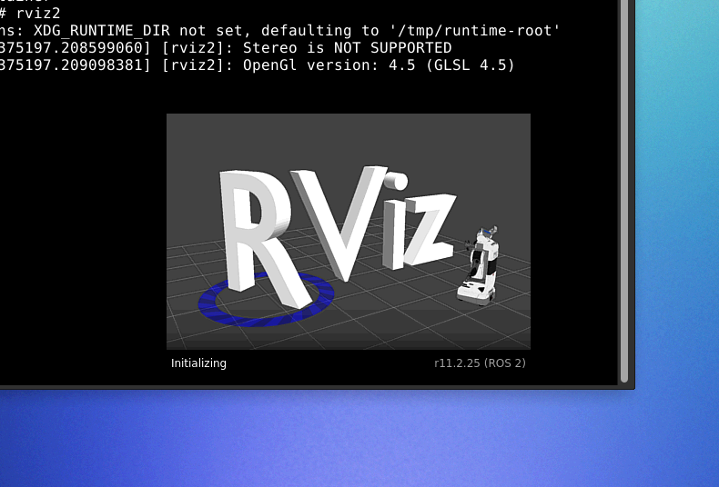

# 【unoQ】ROS2を無理やり入れたにょ【小さなLinux機】

2026年2月18日 09:42


[第一章 初期化](../unoq-setup/)
[第二章 QRB/MCU通信](../unoq-qrb-stm32/)
[第三章 デスクトップを液晶に](../unoq-x11-lcd/)
[第四章 ROS2を簡単に](../unoq-ros2/)
[第五章 Windowsを動かす](../unoq-windows/)

# UNO Q × Ubuntu 22.04 (Jammy) で実現する ROS 2 Humble 最速開発環境構築

UNO Q（ARM64）に Ubuntu 22.04 を導入し、その上で ROS 2 Humble を Docker コンテナとして動作させる構成です。  
ホストとコンテナのOS世代を統一することで、ARM64環境で発生しやすい依存関係の不整合を回避します。

---

# 1. ホストOS構成

## OS

- Ubuntu 22.04 LTS (Jammy Jellyfish)
- アーキテクチャ: ARM64

---

## xrdp（高速GUIリモート接続）

```bash
sudo apt update
sudo apt install xrdp -y
sudo adduser xrdp ssl-cert
sudo systemctl restart xrdp
```

### 特徴

- 追加クライアント不要（mstsc.exeで接続可能）
- 描画転送効率が高い
- 低スペックARM環境でも快適動作

---

## Docker導入

```bash
sudo apt install docker.io -y
sudo systemctl start docker
sudo systemctl enable docker
xhost +local:docker
```

---

# 2. ROS 2 Humble コンテナ起動

使用イメージ:
- ROS 2 Humble Hawksbill
- osrf/ros:humble-desktop

```bash
docker run -it \
--name unoq_ros2_container \
--net=host \
--privileged \
-e DISPLAY=$DISPLAY \
-v /tmp/.X11-unix:/tmp/.X11-unix \
osrf/ros:humble-desktop
```

## オプション解説

| オプション | 理由 |
|------------|------|
| --net=host | DDS通信の安定化 |
| --privileged | USBやデバイスアクセス許可 |
| DISPLAY共有 | GUIアプリ表示 |
| X11マウント | rqtやrvizの動作 |

---

# 3. 時間が掛かる工程（目安）

| 作業 | 所要時間 |
|------|----------|
| イメージPull | 10〜30分 |
| apt更新 | 15〜40分 |
| docker commit | 5〜15分 |

※ ARM64 + eMMC/SD環境ではI/Oがボトルネックになりやすい

---

# 4. 環境の永続化（フリーズ）

## コンテナ内

```bash
source /opt/ros/humble/setup.bash
```

## ホスト側（別ターミナル）

```bash
docker commit unoq_ros2_container my_humble_jammy:v1
```

---

# 5. 爆速起動エイリアス

`~/.bashrc` に追記:

```bash
alias roscore2='xhost +local:docker && docker run -it --rm --net=host --privileged -e DISPLAY=$DISPLAY -v /tmp/.X11-unix:/tmp/.X11-unix my_humble_jammy:v1 /bin/bash -c "source /opt/ros/humble/setup.bash && /bin/bash"'
```

---

# 6. 動作確認

## Terminal A

```bash
roscore2
ros2 run demo_nodes_cpp talker
```

## Terminal B

```bash
roscore2
ros2 topic echo /chatter
```

正常に動作すれば `/chatter` にメッセージが表示される。

---

# なぜこの構成が最速なのか

## 1. Jammy統一

- glibc差異なし
- Mesa/OpenGL競合回避
- ARM64依存パッケージ衝突回避

## 2. xrdp活用

- VNCより軽量
- GUI描画が安定

## 3. Docker隔離

- 環境破壊リスク低減
- イメージ保存で迅速復旧
- 複数バージョン共存可能

# さいごに
いつもご清聴ありがとうございます。
朝活の時間で無事完了しました。


<div class="like-wrap"><div data-lyket-type="like" data-lyket-namespace="linalog" data-lyket-color-icon="#b5e853" data-lyket-color-primary="#b5e853" data-lyket-color-text="#eaeaea" data-lyket-color-secondary="#2b2b2b" data-lyket-id="unoq-ros2"></div></div>
