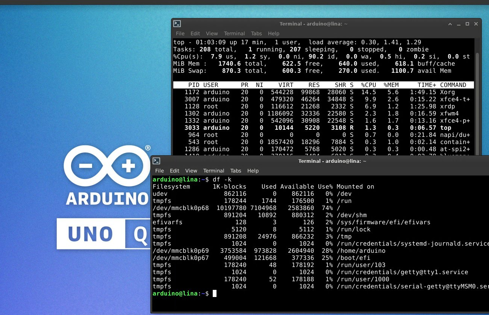
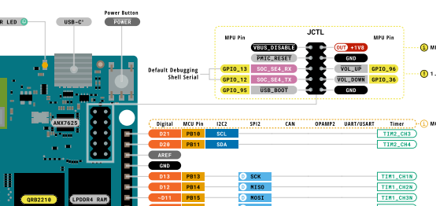

# 【unoQ】Arduino UNO Q 簡単初期セットアップ手順【小さなLinux機】

2026年2月6日 10:54



[第一章 初期化](../unoq-setup/)
[第二章 QRB/MCU通信](../unoq-qrb-stm32/)
[第三章 デスクトップを液晶に](../unoq-x11-lcd/)
[第四章 ROS2を簡単に](../unoq-ros2/)
[第五章 Windowsを動かす](../unoq-windows/)

# はじめに
Arduino UNO Q　初期化覚え書きです
外部HDMIを使わずにPC側からすべてリモートで初期化します 

# ファームウェア更新
よく設定が分からなくなったらまずこれ
工場出荷イメージが古い場合、最新 Debian イメージへの更新を推奨
使用ツール：Arduino Flasher CLI
ダウンロード元：https://www.arduino.cc/en/software/#flasher-tool
### 手順
- UNO Q を PC から一旦抜く
- JCTL ヘッダーの指定ピン（USB-C コネクタから最も遠い2ピン）をジャンパーワイヤーでショート。

- USB-C で PC に接続
- Flasher CLI を実行
```
.\arduino-flasher-cli.exe flash latest
```
- 書き込み完了後、USB を抜き、**ジャンパーを外し**再接続。

==注意 ジャンパーなしでは書き込みが拒否される。
参考ドキュメント：https://docs.arduino.cc/tutorials/uno-q/update-image==

# ADB 接続
PC に ADB をインストール
Windows：https://developer.android.com/tools/releases/platform-tools

### 接続確認
UNO Q がリストに表示されることを確認（初回は許可が必要）。
```
adb devices

```
ユーザー：arduino（初期パスワードは空または arduino）。
```
adb shell

```

### Wi-Fi 設定

#### ADB シェル内で実行
```
nmcli device wifi list
nmcli device wifi connect "YOURSSID" password "YOURPSWD"
```
history に残るので設定後削除推奨

#### 接続確認
```
nmcli connection show --active
ip addr show wlan0 
```

#### 日本語設定
```
sudo apt update
sudo apt install locales language-pack-ja fonts-noto-cjk
sudo locale-gen ja_JP.UTF-8
sudo update-locale LANG=ja_JP.UTF-8
sudo timedatectl set-timezone Asia/Tokyo
```
#### 反映
```
export LANG=ja_JP.UTF-8
source ~/.bashrc
```

# リモートアクセス設定
さぁここまで来たらあとは好きにできます
## RDPの場合
```
sudo apt install xrdp
sudo systemctl enable xrdp
sudo systemctl start xrdp
```
Windows側の RDP で接続

## SSHの場合
```
ssh arduino@UNO-QのIP
```
# さいごに

いやArduino サイズの linux ってなかなか良いかも
4GB RAM/32GB eMMC推奨です
↓更新継続ちぅ
<blockquote class="twitter-tweet" data-theme="dark"><a href="https://twitter.com/chrmlinux03/status/2018853809406304738"></a></blockquote>
<script async src="https://platform.twitter.com/widgets.js" charset="utf-8"></script>

<div class="like-wrap"><div data-lyket-type="like" data-lyket-template="twitter" data-lyket-namespace="linalog" data-lyket-color-icon="#b5e853" data-lyket-color-primary="#b5e853" data-lyket-color-text="#eaeaea" data-lyket-color-secondary="#2b2b2b" data-lyket-id="unoq-setup"></div></div>
