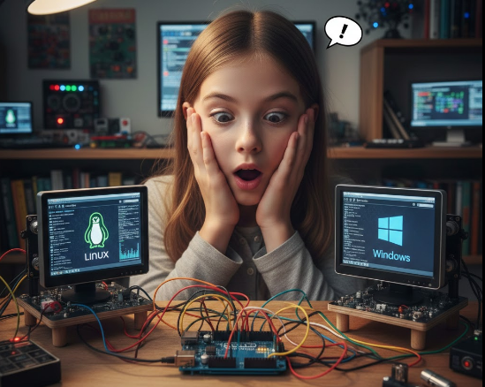
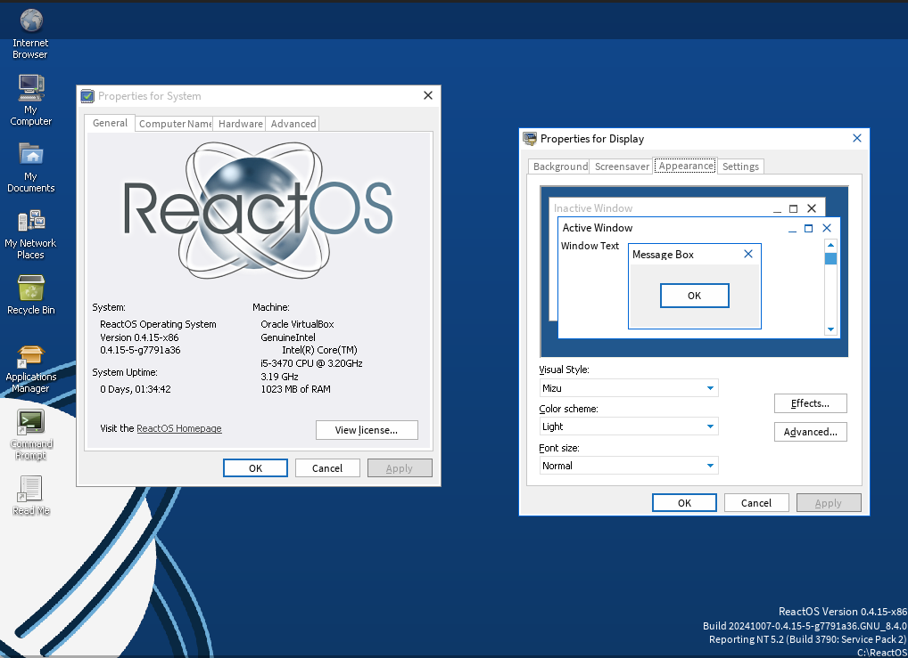

# 【unoQ】Windowsを動かしたにょ【小さなLinux機】

2026年2月25日 10:06



## ここにunoQ 簡単レシピ5部作が完了する

[第一章 初期化](../unoq-setup/)
[第二章 QRB/MCU通信](../unoq-qrb-stm32/)
[第三章 デスクトップを液晶に](../unoq-x11-lcd/)
[第四章 ROS2を簡単に](../unoq-ros2/)
[第五章 Windowsを動かす](../unoq-windows/)

## 2GB/16GBモデルで挑む ReactOS への「極限ダイエット」レシピ

LinaQ の **メモリ 2GB / eMMC 16GB モデル**。\
この限られたリソースを使い切り、Windows 互換 OS「ReactOS」を共存させる。

最大の特徴は、**専用アプリ不要**であること。\
PCでもスマホでも、**ブラウザさえあれば**どこからでも ReactOS
を操作できる環境を構築します。


------------------------------------------------------------------------

## はじめに：2GB モデルだからこそ、削る価値がある

4GB モデルなら余裕で動くかもしれません。\
しかし 2GB モデルで ReactOS を快適に動かすには、OS
レベルでの徹底的な断捨離が不可欠です。

### メモリ 2GB の戦い

Linux システムが抱える不要なメモリ消費を極限まで削ぎ落とし、\
ReactOS に 512MB を安定して明け渡す。

### eMMC 焼き直しの安心感

PC から専用ツールで eMMC を工場出荷状態に戻せるため、\
失敗を恐れずストイックなカスタマイズが可能です。

------------------------------------------------------------------------

## ストレージの「断捨離」ビフォーアフター

  状態               使用量 (Used)    空き容量 (Available)   使用率
  ------------------ ---------------- ---------------------- ----------
  クリーンアップ前   約 1.9 GB        約 7.8 GB              約 20%
  クリーンアップ後   約 0.7〜0.8 GB   約 9.0 GB 以上         約 7〜8%

Docker や GUI スタックを削除することで、\
1GB 以上の余白を確保できます。

------------------------------------------------------------------------

## 準備：システムの徹底クリーンアップ

以下を `slimdown.sh` として保存し、sudo で実行してください。

``` bash
#!/bin/bash
set -e

if [ "$EUID" -ne 0 ]; then
  echo "Please run as root (use sudo)"
  exit 1
fi

echo "[1/9] GUI / メディアスタックの削除"
apt purge -y xserver-* x11-* libx11-* libwayland-* mesa-* libgl1* gstreamer-* qt* pulseaudio alsa-utils || true

echo "[2/9] 開発ツール & Dockerの完全排除"
apt purge -y build-essential gcc g++ make llvm-* git docker-ce docker-ce-cli containerd.io || true

echo "[3/9] 印刷 / その他不要サービスの削除"
apt purge -y cups* avahi-daemon || true

echo "[4/9] キャッシュクリア"
apt autoremove --purge -y
apt clean
rm -rf /var/lib/apt/lists/*

echo "[5/9] Docker データの物理削除"
rm -rf /var/lib/docker /var/lib/containerd

echo "[6/9] ドキュメント & ロケールの削除"
rm -rf /usr/share/man/* /usr/share/doc/* /usr/share/icons /usr/share/themes /usr/share/backgrounds /usr/share/sounds
find /usr/share/locale/ -maxdepth 1 -mindepth 1 -not -name 'en*' -exec rm -rf {} +
rm -rf /usr/share/i18n

echo "[7/9] 不要なファームウェアの削減"
rm -rf /usr/lib/firmware/amdgpu /usr/lib/firmware/radeon /usr/lib/firmware/intel /usr/lib/firmware/nvidia /usr/lib/firmware/mellanox /usr/lib/firmware/netronome /usr/lib/firmware/qcom/venus*

echo "[8/9] ログとフォントの削除"
rm -rf /usr/share/fonts/* /usr/share/mime/*
journalctl --vacuum-time=1s || true

echo "[9/9] サービスの停止"
systemctl disable cups 2>/dev/null || true
systemctl disable avahi-daemon 2>/dev/null || true

echo "Done."
```

------------------------------------------------------------------------
```
初期化直後
arduino@uno-q:/$ df
Filesystem      1K-blocks    Used Available Use% Mounted on
udev               865216       0    865216   0% /dev
tmpfs              178244    1580    176664   1% /run
/dev/mmcblk0p68  10197780 6606040   3082788  69% /
tmpfs              891208       8    891200   1% /dev/shm
efivarfs              128       3       126   2% /sys/firmware/efi/efivars
tmpfs                5120       8      5112   1% /run/lock
tmpfs              891208    2484    888724   1% /tmp
tmpfs                1024       0      1024   0% /run/credentials/systemd-journald.service
/dev/mmcblk0p69   3753584  627672   2952812  18% /home/arduino
/dev/mmcblk0p67    499004  115472    383532  24% /boot/efi
tmpfs              178240      48    178192   1% /run/user/103
tmpfs                1024       0      1024   0% /run/credentials/getty@tty1.service
tmpfs                1024       0      1024   0% /run/credentials/serial-getty@ttyMSM0.service
arduino@uno-q:/$

断捨離後
arduino@uno-q:~$ df
Filesystem      1K-blocks    Used Available Use% Mounted on
udev               865216       0    865216   0% /dev
tmpfs              178244    1560    176684   1% /run
/dev/mmcblk0p68  10197780 1897544   7791284  20% /
tmpfs              891208      12    891196   1% /dev/shm
efivarfs              128       3       126   2% /sys/firmware/efi/efivars
tmpfs                5120       8      5112   1% /run/lock
tmpfs              891208    2480    888728   1% /tmp
tmpfs                1024       0      1024   0% /run/credentials/systemd-journald.service
/dev/mmcblk0p69   3753584  627688   2952796  18% /home/arduino
/dev/mmcblk0p67    499004  115472    383532  24% /boot/efi
tmpfs                1024       0      1024   0% /run/credentials/getty@tty1.service
tmpfs                1024       0      1024   0% /run/credentials/serial-getty@ttyMSM0.service
tmpfs              178240      44    178196   1% /run/user/1000
arduino@uno-q:~$
```

## ReactOS の正当性
https://reactos.org/


==ReactOS は Windows バイナリを使用せず、\
クリーンルーム設計で開発されたオープンソース OS です。==
------------------------------------------------------------------------

## 基盤ツールのインストール

``` bash
sudo apt update
sudo apt install qemu-system-x86 qemu-utils novnc python3-websockify xvfb openbox x11vnc unzip -y
```

------------------------------------------------------------------------

## ブラウザ操作環境（noVNC）の起動

``` bash
# 仮想ディスプレイ
Xvfb :1 -screen 0 1024x768x24 &
export DISPLAY=:1
openbox &

# VNC + Web変換
x11vnc -display :1 -nopw -listen localhost -xkb -forever &
websockify --web /usr/share/novnc/ 6080 localhost:5900 &
```

------------------------------------------------------------------------

## ReactOS 構築レシピ

``` bash
mkdir -p ~/vms/reactos && cd ~/vms/reactos
qemu-img create -f qcow2 reactos_drive.qcow2 2G

wget https://iso.reactos.org/reactos/ReactOS-0.4.14-release-74-g9081054.zip
unzip ReactOS-0.4.14-release-74-g9081054.zip

export DISPLAY=:1
qemu-system-x86_64 -m 512M   -hda reactos_drive.qcow2   -vga std   -net nic,model=ne2k_pci -net user   -boot c &
```

------------------------------------------------------------------------

##  操作方法

ブラウザで以下へアクセス：

    http://<LinaQのIPアドレス>:6080/vnc.html

SSHトンネル使用時：

``` bash
ssh -L 6080:localhost:6080 arduino@<LinaQのIPアドレス>
```

その後：

    http://localhost:6080/vnc.html

------------------------------------------------------------------------

## まとめ

2GB という制約の中で、\
不要なものを削ぎ落とし、ReactOS を共存させる。

専用アプリ不要、ブラウザだけで操作可能な環境。\
これが LinaQ × ReactOS の極限構築レシピです。

## さいごに
<blockquote class="twitter-tweet" data-theme="dark"><a href="https://twitter.com/chrmlinux03/status/2025491817157034319"></a></blockquote>
<script async src="https://platform.twitter.com/widgets.js" charset="utf-8"></script>
いつもご清聴ありがとうございます。
エンジニアはロマンですね(謎

<div class="like-wrap"><div data-lyket-type="like" data-lyket-template="twitter" data-lyket-namespace="linalog" data-lyket-color-icon="#b5e853" data-lyket-color-primary="#b5e853" data-lyket-color-text="#eaeaea" data-lyket-color-secondary="#2b2b2b" data-lyket-id="unoq-windows"></div></div>
