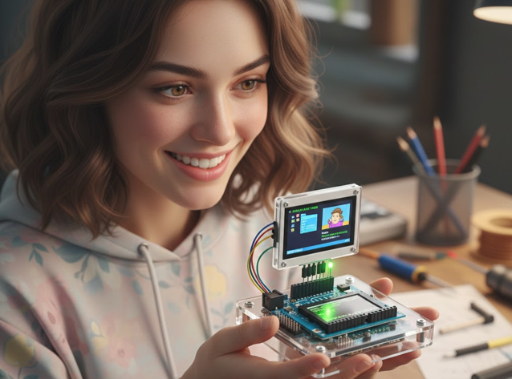

# 【unoQ】QRB側X11をSTM32のLCDに表示出来たにょ【小さなLinux機】

2026年2月11日 16:00
<p class="article-tags">タグ: <a href="..?tag=Arduino">Arduino</a> <a href="..?tag=linux">linux</a> <a href="..?tag=unoQ">unoQ</a></p>



[第一章 初期化](../unoq-setup/)
[第二章 QRB/MCU通信](../unoq-qrb-stm32/)
[第三章 デスクトップを液晶に](../unoq-x11-lcd/)
[第四章 ROS2を簡単に](../unoq-ros2/)
[第五章 Windowsを動かす](../unoq-windows/)

# はじめに
第三章です
ついに QRBとSTM32側で双方向な通信をさせました

# コード

```
# arduino-routerを止める
sudo systemctl stop arduino-router
```

```
# python で使うモジュールを持ってくる
sudo apt-get install scrot python3-pil python3-numpy python3-serial
```
```
#!/usr/bin/env python3
import serial
import time
import numpy as np
import subprocess
from PIL import Image
import os
import argparse

class TFT_UART:
    CMD_FILL_SCREEN = 0x02
    CMD_DRAW_PARTIAL = 0x05
    
    def __init__(self, port='/dev/ttyHS1', baudrate=921600):
        self.ser = serial.Serial(port, baudrate, timeout=2)
        time.sleep(2)
        self.ser.reset_input_buffer()
        print(f"Serial port {port} opened at {baudrate} bps")
    
    def wait_ack(self, timeout=1.0):
        start = time.time()
        while (time.time() - start) < timeout:
            if self.ser.in_waiting > 0:
                ack = self.ser.read(1)
                if ack[0] == 0xAA:
                    return True
            time.sleep(0.001)
        return False
    
    def fill_screen(self, color):
        payload = bytes([self.CMD_FILL_SCREEN]) + color.to_bytes(2, 'big')
        self.ser.write(payload)
        return self.wait_ack()
    
    def draw_partial(self, x, y, w, h, fb_tile):
        header = bytes([self.CMD_DRAW_PARTIAL]) + \
                 x.to_bytes(2, 'big') + \
                 y.to_bytes(2, 'big') + \
                 w.to_bytes(2, 'big') + \
                 h.to_bytes(2, 'big')
        
        fb_bytes = fb_tile.astype('>u2').tobytes()
        
        self.ser.write(header + fb_bytes)
        
        return self.wait_ack()

class DifferentialUpdater:
    def __init__(self, width=320, height=240, tile_size=40):
        self.width = width
        self.height = height
        self.tile_size = tile_size
        self.prev_frame = None
        self.tiles_x = (width + tile_size - 1) // tile_size
        self.tiles_y = (height + tile_size - 1) // tile_size
    
    def find_changed_tiles(self, current_frame):
        if self.prev_frame is None:
            self.prev_frame = current_frame.copy()
            return [(0, 0, self.width, self.height)]
        
        changed_regions = []
        for ty in range(self.tiles_y):
            for tx in range(self.tiles_x):
                x, y = tx * self.tile_size, ty * self.tile_size
                w = min(self.tile_size, self.width - x)
                h = min(self.tile_size, self.height - y)
                
                if not np.array_equal(current_frame[y:y+h, x:x+w], self.prev_frame[y:y+h, x:x+w]):
                    changed_regions.append((x, y, w, h))
        
        self.prev_frame = current_frame.copy()
        return changed_regions

class X11ScreenCapture:
    def __init__(self, display=None, target_width=320, target_height=240):
        self.display = display or os.environ.get('DISPLAY', ':0')
        self.target_width = target_width
        self.target_height = target_height
        self.temp_file = '/tmp/x11_frame.png'
    
    def capture_to_rgb565(self):
        try:
            subprocess.run(['scrot', '-o', self.temp_file], 
                           env={**os.environ, 'DISPLAY': self.display},
                           check=True, capture_output=True)
            
            with Image.open(self.temp_file) as img:
                img = img.resize((self.target_width, self.target_height), Image.Resampling.NEAREST)
                pixels = np.array(img.convert('RGB'))
            
            r = pixels[:, :, 0].astype(np.uint16)
            g = pixels[:, :, 1].astype(np.uint16)
            b = pixels[:, :, 2].astype(np.uint16)
            
            rgb565 = ((r & 0xF8) << 8) | ((g & 0xFC) << 3) | (b >> 3)
            return rgb565
        except Exception as e:
            print(f"Capture error: {e}")
            return None

def main():
    parser = argparse.ArgumentParser()
    parser.add_argument('--port', default='/dev/ttyHS1')
    parser.add_argument('--baud', type=int, default=921600)
    parser.add_argument('--fps', type=int, default=10)
    args = parser.parse_args()

    tft = TFT_UART(args.port, args.baud)
    capture = X11ScreenCapture(target_width=320, target_height=240) # ROT90用
    differ = DifferentialUpdater(width=320, height=240, tile_size=40)

    print("Clearing Screen...")
    tft.fill_screen(0x0000)

    frame_interval = 1.0 / args.fps
    
    try:
        while True:
            start_time = time.time()
            
            fb = capture.capture_to_rgb565()
            if fb is not None:
                changes = differ.find_changed_tiles(fb)
                for rect in changes:
                    x, y, w, h = rect
                    tile_data = fb[y:y+h, x:x+w]
                    if not tft.draw_partial(x, y, w, h, tile_data):
                        print("Timeout/Error in transmission")
            
            elapsed = time.time() - start_time
            time.sleep(max(0, frame_interval - elapsed))
            
    except KeyboardInterrupt:
        print("\nExit.")

if __name__ == '__main__':
    main()
```

# まとめ
<blockquote class="twitter-tweet" data-theme="dark"><a href="https://twitter.com/chrmlinux03/status/2021456151200792711"></a></blockquote>
<script async src="https://platform.twitter.com/widgets.js" charset="utf-8"></script>

<div class="like-wrap"><div data-lyket-type="like" data-lyket-template="twitter" data-lyket-namespace="linalog" data-lyket-color-icon="#b5e853" data-lyket-color-primary="#b5e853" data-lyket-color-text="#eaeaea" data-lyket-color-secondary="#2b2b2b" data-lyket-id="unoq-x11-lcd"></div></div>
