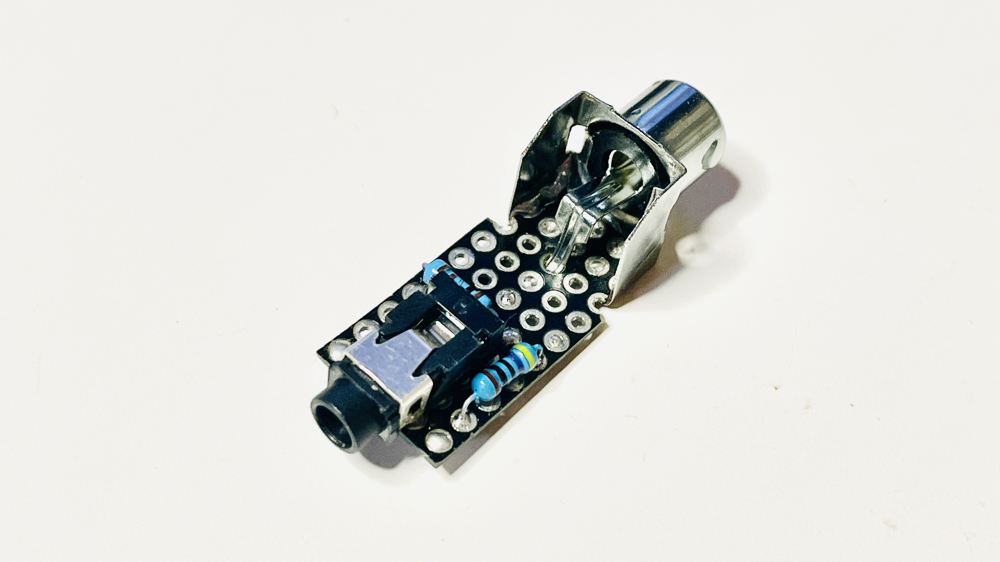

# [USBDAC]基板が小さくなったにょ[CVBS]

2026年6月18日 11:41


# 最終版ハードウェア

試作を何度か重ねた結果、回路は小型のユニバーサル基板上に構成したシンプルなパッシブミキサーへと集約された。

## 回路構成

最終的な回路は以下で構成される。

| 部品 | 用途 |
|------|------|
| 3.5 mm オーディオジャック | 入力 |
| RCA コンポジット映像コネクタ | 出力 |
| 470 Ω 抵抗 | 映像信号（L チャンネル） |
| 1 kΩ 抵抗 | 同期信号（R チャンネル） |

## 接続図

```text
Audio Output

Tip (L)  ---- 470Ω ----+
                       +---- RCA Center (CVBS)
Ring (R) ---- 1kΩ -----+

Sleeve (GND) ---------- RCA Shield (GND)
```

## 実装

変換回路全体は小さなユニバーサル基板上に収まり、アクティブ部品は一切使用していない。

このハードウェアは、本プロジェクトで採用している **NTSC オーディオエンコード方式**を直接実装したものである。

- 左チャンネルが映像（輝度）信号を出力
- 右チャンネルが同期信号を出力
- 両チャンネルを抵抗で合成し、標準的な NTSC コンポジット映像信号を生成

当初のブレッドボード試作機と比較して、最終版はより堅牢でコンパクトな構成となり、長期運用にも適している。


## まとめ

この回路は本プロジェクトにおける **NTSC 出力の最終リファレンスハードウェア**である。

Spresense の Hi-Res AudioPlayer を用いた再生だけでなく、本プロジェクトで生成される 192 kHz および 384 kHz のすべての NTSC RAW データに共通して使用でき、再生プラットフォームに依存せずコンポジット映像信号へ変換することができる。

詳細は ☞ [hackaday.io](https://hackaday.io/project/205934-spresense-audio-jack-as-ntsc-video-output)
