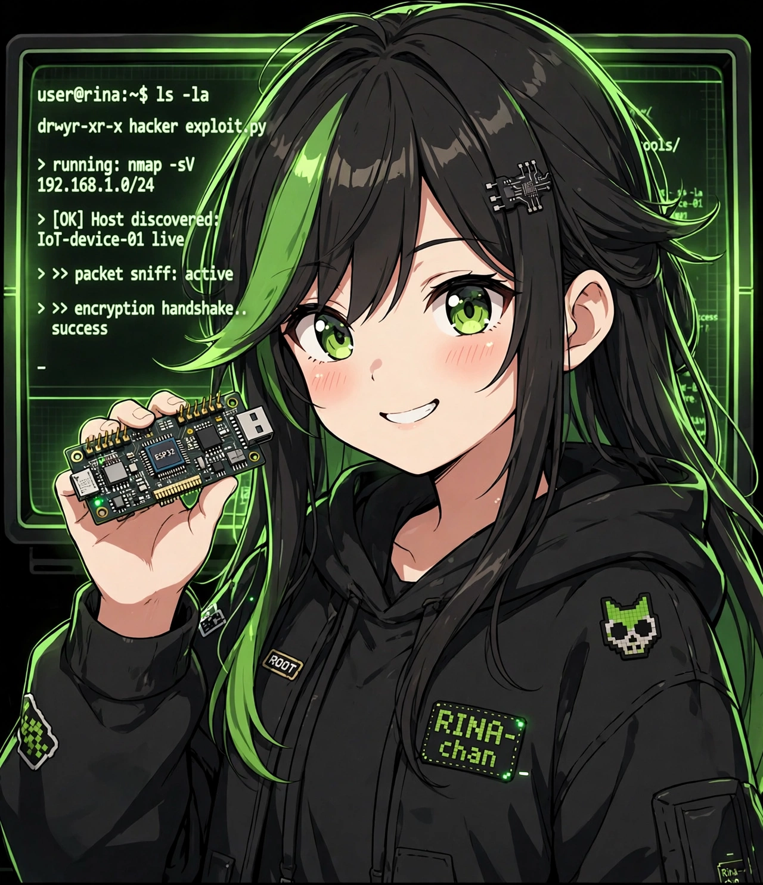

# [Junction] Windows の C ドライブを空ける話 [目から鱗]

2026年11月23日 13:54

<p></p>

## きっかけ

C ドライブ（SSD 474 GB）の空きが心もとなくなってきたので、大きなフォルダを別のドライブ（E:、HDD 1.86 TB）へ移すことにしました。対象は開発環境とゲームで、合計約 100 GB 分です。

| 対象 | サイズ | 移し方 | 結果 |
| --- | --- | --- | --- |
| Arduino15（Arduino IDE のコア・ツール置き場） | 約 23 GB | 設定ファイルで保存先を変更 | 成功（ただし一波乱あり。本文参照） |
| Arduino IDE 1.8.19（ポータブル版） | 約 22.8 GB | フォルダごと移動 | 成功 |
| WSL Ubuntu-24.04 の仮想ディスク | 約 25.3 GB | `wsl --manage --move` | 成功 |
| ゲーム（NIKKE） | 約 29 GB | ジャンクション | 成功 |

無事に終わってみれば簡単な話なのですが、Arduino15 でジャンクションの落とし穴にはまりました。その記録です。

## ジャンクションとは

ジャンクションは、NTFS の機能で作る「フォルダへのリンク」です。例えば `C:\NIKKE` というジャンクションを作って `E:\NIKKE` を指すようにすると、プログラムからは今まで通り `C:\NIKKE` にファイルがあるように見えますが、実物は E: に置かれます。経路を決め打ちしているソフトでも、引っ越しに気づきません。

似たものとの違いは次の通りです。

- ショートカット（.lnk）：エクスプローラーが解釈するだけのファイルで、プログラムは辿れません。今回の用途には使えません。
- シンボリックリンク：ファイルにもフォルダにも張れますが、作成に管理者権限か開発者モードが必要です。
- ジャンクション：フォルダ専用ですが、管理者権限なしで作れます。指す先は絶対パスのみです。

作成は PowerShell なら次の 1 行です。

```powershell
New-Item -ItemType Junction -Path "C:\NIKKE" -Target "E:\NIKKE"
```

function expandCode(event) {
          var codeBlock = event.currentTarget;
          var triangle = codeBlock.querySelector('.triangle');
          if (!codeBlock.classList.contains('expanded')) {
            codeBlock.classList.add('expanded');
            triangle.classList.add('up');
          }
        }

        function toggleCode(event) {
          var codeBlock = event.currentTarget;
          var triangle = event.currentTarget.querySelector('.triangle');;
          if (codeBlock.classList.contains('expanded')) {
            codeBlock.classList.remove('expanded');
            triangle.classList.remove('up');
          } else {
            expandCode({ currentTarget: codeBlock });
          }
          event.stopPropagation();
        }

コマンドプロンプトでは `mklink /J C:\NIKKE E:\NIKKE` です。

外すときは、リンク側に対して削除を行います。実物は消えません。

```powershell
cmd /c rmdir "C:\NIKKE"
```

function expandCode(event) {
          var codeBlock = event.currentTarget;
          var triangle = codeBlock.querySelector('.triangle');
          if (!codeBlock.classList.contains('expanded')) {
            codeBlock.classList.add('expanded');
            triangle.classList.add('up');
          }
        }

        function toggleCode(event) {
          var codeBlock = event.currentTarget;
          var triangle = event.currentTarget.querySelector('.triangle');;
          if (codeBlock.classList.contains('expanded')) {
            codeBlock.classList.remove('expanded');
            triangle.classList.remove('up');
          } else {
            expandCode({ currentTarget: codeBlock });
          }
          event.stopPropagation();
        }

注意点として、ジャンクションを張ったフォルダに対して再帰削除（`Remove-Item -Recurse` など）を実行すると、リンク先の中身まで消してしまうことがあります。削除は必ず「リンク自体」と「実物」を分けて考えてください。

## 本題：ジャンクションで Arduino が壊れた

### やったこと

Arduino15 は通常 `C:\Users\<ユーザー名>\AppData\Local\Arduino15` にあります。これを E: へコピーし、元の場所にジャンクション（フォルダへのリンク）を張りました。見た目の経路は今まで通り、中身だけ E: にある状態です。

エクスプローラーでも PowerShell でも中身は普通に見えます。ところが Arduino IDE を起動すると、

- インストール済みのはずのコアが「インストールする必要があります」と言われる
- ボード選択でボードが見つからない

という状態になりました。

### 切り分け

ファイルは全部あるのか、設定は正しいのか、順に確認しました。

- コピー漏れではない：元フォルダとコピー先でファイル数・総容量を比較し、一致（むしろコピー先の方が新しい分だけ多い）
- 設定は正しい：`arduino-cli.yaml` の `directories.data` は元の経路のまま、`directories.user`（スケッチブック）も元のまま
- コアの実物もある：`packages\m5stack\hardware\esp32\3.3.10\platform.txt` は存在する

IDE の画面だけでは埒が明かないので、IDE が裏で使っている `arduino-cli` を直接叩いて `core list` を実行しました。出てきたのがこれです。

```
Error loading hardware platform: following symlink c:\Users\...\AppData\Local\Arduino15\packages: The system cannot find the path specified.
...
No platforms installed.
```

function expandCode(event) {
          var codeBlock = event.currentTarget;
          var triangle = codeBlock.querySelector('.triangle');
          if (!codeBlock.classList.contains('expanded')) {
            codeBlock.classList.add('expanded');
            triangle.classList.add('up');
          }
        }

        function toggleCode(event) {
          var codeBlock = event.currentTarget;
          var triangle = event.currentTarget.querySelector('.triangle');;
          if (codeBlock.classList.contains('expanded')) {
            codeBlock.classList.remove('expanded');
            triangle.classList.remove('up');
          } else {
            expandCode({ currentTarget: codeBlock });
          }
          event.stopPropagation();
        }

**arduino-cli がジャンクションを辿れず、`packages` フォルダが空に見えていた**のが原因でした。ファイルの読み書き自体はジャンクション越しに通るのに、プラットフォームの走査（シンボリックリンクの評価）だけが失敗する、という厄介な壊れ方です。

### 解決

ジャンクションを外し、設定で保存先を直接 E: に向けました。`arduino-cli.yaml` の該当行を書き換えます。

```yaml
directories:
    data: E:\Arduino15
    builtin:
        libraries: E:\Arduino15\libraries
```

function expandCode(event) {
          var codeBlock = event.currentTarget;
          var triangle = codeBlock.querySelector('.triangle');
          if (!codeBlock.classList.contains('expanded')) {
            codeBlock.classList.add('expanded');
            triangle.classList.add('up');
          }
        }

        function toggleCode(event) {
          var codeBlock = event.currentTarget;
          var triangle = event.currentTarget.querySelector('.triangle');;
          if (codeBlock.classList.contains('expanded')) {
            codeBlock.classList.remove('expanded');
            triangle.classList.remove('up');
          } else {
            expandCode({ currentTarget: codeBlock });
          }
          event.stopPropagation();
        }

この状態で `arduino-cli core list` を実行すると、インストール済みのコアが全部戻ってきました。IDE でもボードが選べ、コンパイルが通ることを確認してから、C: 側の退避フォルダを削除しました。

## 他の対象について

### Arduino IDE 1.8.19（ポータブル版）

フォルダの中の `portable` フォルダが 22.3 GB を占めていました。ポータブル構成はフォルダ内で完結しているので、フォルダごと E: へ移動するだけで、そのまま起動できました。緊急用の環境なので、消さずに移すだけです。

### WSL の仮想ディスク

WSL はディストリビューションごとに仮想ディスク（ext4.vhdx）を持ちます。Ubuntu-22.04 は最初から E: にありましたが、Ubuntu-24.04 は C: にあり、25.3 GB ありました。最近の WSL には移動用のコマンドがあります。

```powershell
wsl --shutdown
wsl --manage Ubuntu-24.04 --move E:\WSL\Ubuntu-24.04
```

function expandCode(event) {
          var codeBlock = event.currentTarget;
          var triangle = codeBlock.querySelector('.triangle');
          if (!codeBlock.classList.contains('expanded')) {
            codeBlock.classList.add('expanded');
            triangle.classList.add('up');
          }
        }

        function toggleCode(event) {
          var codeBlock = event.currentTarget;
          var triangle = event.currentTarget.querySelector('.triangle');;
          if (codeBlock.classList.contains('expanded')) {
            codeBlock.classList.remove('expanded');
            triangle.classList.remove('up');
          } else {
            expandCode({ currentTarget: codeBlock });
          }
          event.stopPropagation();
        }

### ゲーム（NIKKE）

こちらはジャンクションで問題ありませんでした。経路は `C:\NIKKE` のまま、実物だけ E: へ移しています。今後のアップデートで増える分も E: 側に載ります。

## 教訓

- **設定で移せるものは、設定で移す。** WSL の `--move` や `arduino-cli.yaml` のように、正規の方法があるものはそちらが確実です。
- **ジャンクションは「経路を変えられないソフト」への手段。** 通常の Windows アプリやゲームには有効ですが、リンクの辿り方に癖のあるツール（今回の arduino-cli）では壊れます。
- **移動は「コピー → 退避 → 切替 → 検証 → 退避を削除」の順で。** いきなり元を消さないことが、切り分けの余地を残します。

<div class="like-wrap"><div data-lyket-type="like" data-lyket-namespace="linalog" data-lyket-id="windows-disk"></div></div>
