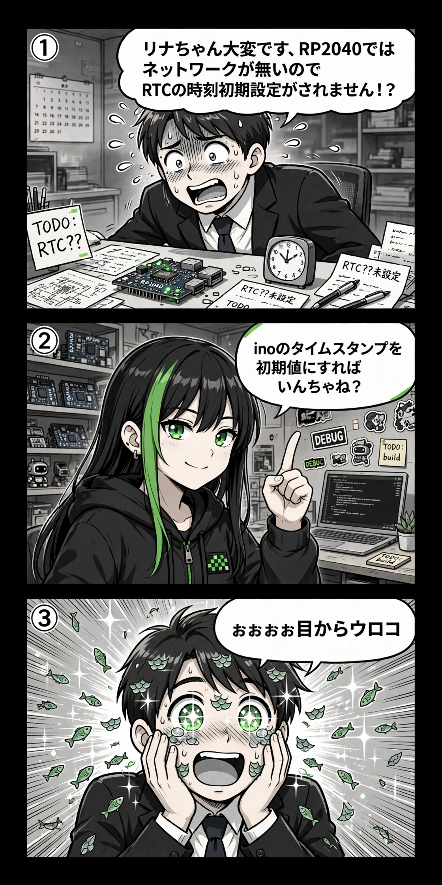

# RP2040 の RTC を ino のタイムスタンプで合わせた件

2026年11月28日 09:29
<p class="article-tags">タグ: <a href="..?tag=XIAO">XIAO</a> <a href="..?tag=RP2040">RP2040</a> <a href="..?tag=RTC">RTC</a></p>

<p></p>

XIAO Expansion Board v1.1 に XIAO RP2040 を挿して、RTC（PCF8563）と OLED（SSD1306）のテストをしたときの話。

## RTC は工場出荷時の時刻だった

起動すると 2020-10-23 が表示される。曜日まで合っているので、製造時の検査プログラムが書いた時刻が残っていると見られる。

VL フラグ（電圧低下で時刻が信用できないことを示すフラグ）は下りていた。つまり RTC 自身は「自分の時刻は正しい」と申告している。であるなら、スケッチが電池で保持されている時刻を勝手に上書きするのは間違いで、何もしないのが正しい。合わせ直す入口は、意思を示す経路だけに用意した。

## ネットワークが無いので __TIMESTAMP__

RP2040 にはネットワークが無いので、NTP で合わせることはできない。そこで初期値には `__TIMESTAMP__` を使う。これはコンパイル時に、その ino ファイルの最終更新日時に展開されるマクロである。VL が立って時刻が信用できないときだけ、これを初期値として RTC に書く。

正確に合わせたいときは、起動後に PC からシリアルで次の形式で送る。

```
T2026-11-28 09:29:00
```

## 表示は LovyanGFX に

最初は U8g2 で表示していた。SSD1306 には表示側のダブルバッファが無いので、LovyanGFX の 1 ビットスプライトに描いて一括転送する形に替えた。

回転の番号の意味はライブラリごとに違う。U8g2 の R2 と LovyanGFX の 2 が同じ向きになるとは限らないので、目で合わせて決め直した。写真に縞が出る対策として、パネルのフレームレートも最大側に上げてある（コマンド 0xD5）。

## 電源を切っても大丈夫だった

一晩、電源を切ったまま置いて、朝に確認したら時刻は合っていた。バックアップ電池で RTC は回り続けていた。一度合わせておけば、あとは RTC が自分で刻み続ける。

X への投稿:

<blockquote class="twitter-tweet" data-theme="dark"><a href="https://twitter.com/chrmlinux03/status/2126448684410052722"></a></blockquote>
<script async src="https://platform.twitter.com/widgets.js" charset="utf-8"></script>

## 3 コマ漫画

<p></p>

<div class="like-wrap"><div data-lyket-type="like" data-lyket-template="twitter" data-lyket-namespace="linalog" data-lyket-id="xiao-rtc-timestamp" data-lyket-color-icon="#b5e853" data-lyket-color-primary="#b5e853" data-lyket-color-text="#eaeaea" data-lyket-color-secondary="#2b2b2b"></div></div>
